# UI audit and settings redesign

Settings now shows one category at a time, with descriptions and search across categories. The shared interface uses Hulu's green and rich black with the approved Satoshi fallback. Home and Feed retain their layouts.

The [design guide](../../../branding/design-guide.md) defines the rules for future UI work. [Hulu's brand reference](https://www.thisishulu.com/) is the source for the accent color, background color and Graphik typography reference.

## Findings and fixes

| Finding | Evidence | Fix |
| --- | --- | --- |
| Settings required scanning unrelated categories | The initial document was 3,772 px high on desktop and 3,834 px on mobile | Show one category, with side navigation on desktop and a native selector on mobile |
| Collapsed sections did not explain what they contained | Headers showed only short names such as TTS and Cleanup | Add descriptions to all sections and categories |
| Search missed readable field labels | The matcher indexed technical keys and group notes, but not `settingLabel()` | Search names, descriptions, labels and technical keys; allow terms in any order |
| Widget drafts disappeared on collapse or filtering | `CollapsibleSection` unmounted its children; widget editors store their own drafts | Mount on first expansion, then hide without unmounting; retain editors across categories |
| Typography contradicted the branding guide | The guide named Satoshi for the wordmark; CSS used JetBrains Mono. Labels, notices and episode metadata also used mono text | Use Satoshi for the interface, including Home, Feed and players; retain system mono only for code and diagnostic values |
| The webfont request silently failed | The combined Satoshi/JetBrains Mono URL returned an empty stylesheet, leaving the browser on fallback fonts | Request Satoshi alone and require a loaded Satoshi font face before taking after screenshots |
| Color definitions could drift | Branding JSON, unused token CSS, Tailwind and component CSS separately defined colors | Generate token CSS from JSON, import it, map Tailwind to it, and reject stale generated CSS during build |
| The muted token was too dark for small text | Branding specified `#6b6b78`, a 3.77:1 ratio on the card background; frontend muted text already used `#9a9aaa` | Make `#9a9aaa` canonical; reserve the darker gray for decorative controls |
| Processing tags had low text contrast | `#fef3c7` on `#b9831a` yields 2.98:1 | Use `#fcd67a` on `#3b2b0a`, yielding 9.79:1 |
| Disclosure semantics and focus feedback were incomplete | Section buttons lacked `aria-controls`; cleanup prompt lacked an accessible name; switch focus removed its outline | Connect each disclosure to its body, label the editor and restore a visible switch outline |
| Motion preferences applied only to the save bar | Queued and processing pulses and other transitions continued | Apply reduced-motion behavior to shared animations and transitions |
| Search text could run beneath its clear button | The input reserved left padding but no right padding | Reserve space for the clear action and return focus to search after clearing |
| Secondary screens kept older typography | Login errors and settings help, feedback and voice metadata still used monospace | Use Satoshi throughout; keep monospace for prompt syntax, raw credentials and diagnostic values |
| Shared controls differed by element type | Upload labels lacked visible keyboard focus; action rows could not wrap | Share inline-flex button sizing, show upload focus and wrap settings actions on narrow screens |
| Warning and artwork colors bypassed tokens | The open-mode banner used Tailwind amber; failed artwork used a literal background | Use the shared warning and surface tokens |
| Errors could look like success | Feed action failures and incorrect admin passwords used green feedback | Use danger text and alert semantics for failures; add missing prompt and correction save errors |
| Some documented settings could not be found | Cleanup window was absent; widget search omitted cookie jars and sidecar field names | Add the cleanup window control and widget search metadata |
| Remote credentials differed from other keys | TTS and Whisper API keys were absent from `MASKED_KEYS` | Mask both fields and retain their string values when saving |

## Documentation audit

The configuration inventory matches all 163 keys in the real backend's runtime allowlist. The environment reference covers every key. Local file links, screenshots and heading anchors resolve across the project README, documentation index, topic guides, brand guide and this audit.

| Gap | Correction |
| --- | --- |
| Configuration omitted Sidecar settings and Operations | Add both groups and separate Security policies from Admin access |
| Setup and topic guides named outdated settings locations | Include category paths for passwords, AI providers, voices, feed controls and extraction |
| Save behavior was ambiguous | Distinguish generic Save settings, widget save buttons and immediate voice/chime/feed-auth changes |
| Glossary links used an old pipeline heading | Point cleanup, normalization, summary and pronunciation links at the current heading |
| Reset documentation said shipped defaults only | Explain that reset restores environment or code defaults |
| Frontend build instructions omitted shared files | Document token generation, validation and the required sibling directories; update Docker copy paths |
| Local HTTP sign-in guidance omitted cookie policy | Document the Secure session cookie setting for HTTP and HTTPS |

Contrast ratios use relative luminance from the CSS colors and are rounded to two decimal places. They describe those specific color pairs, not a full accessibility certification.

## Before and after

Screenshots use the real React frontend and FastAPI backend with a fresh local database. No fabricated episodes or mocked API responses were used. The open-mode banner is visible in both versions. The default local configuration has no populated feed or running speech/render sidecars.

The baseline is commit `57b7f4b81eccb1974bd7ffc32eb91f64251e68eb`. Both captures use Chrome, a fresh browser profile, a device scale of 1, reduced motion, and the same viewport sizes.

| Viewport | Initial settings height before | Initial settings height after |
| --- | --- | --- |
| Desktop, 1,440 x 1,000 px | 3,772 px | 1,000 px |
| Mobile, 390 x 844 px | 3,834 px | 1,124 px |

Heights come from `document.documentElement.scrollHeight` in [before.json](before.json) and [after.json](after.json). The desktop after value is the viewport minimum. These measurements describe the default collapsed category view, not the height of every expanded form.

### Settings desktop

| Before | After |
| --- | --- |
| 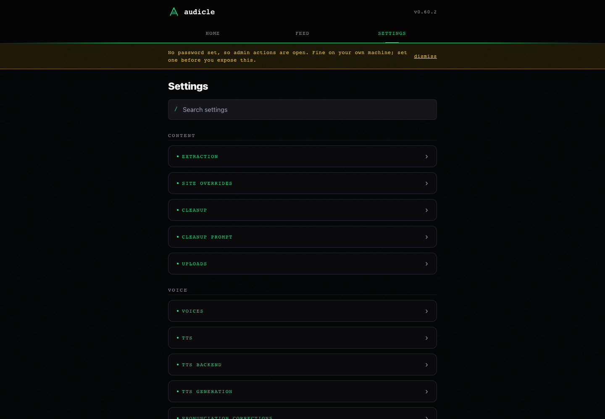 | 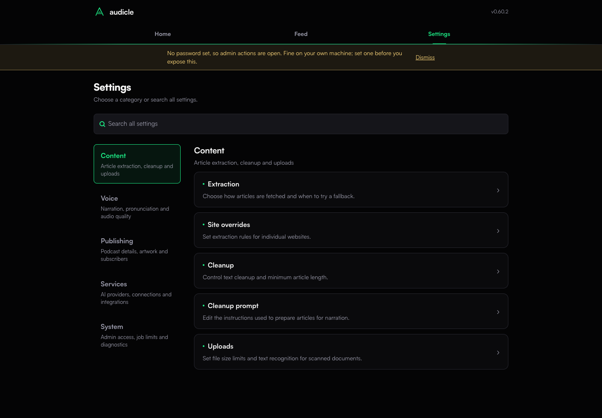 |

### Settings mobile

| Before | After |
| --- | --- |
| 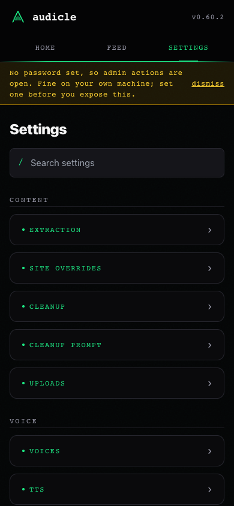 |  |

### Settings search

Both views search for `CHAPTERS_TARGET_SECONDS`. The updated search also accepts the visible label, "target chapter length".

| Before | After |
| --- | --- |
| 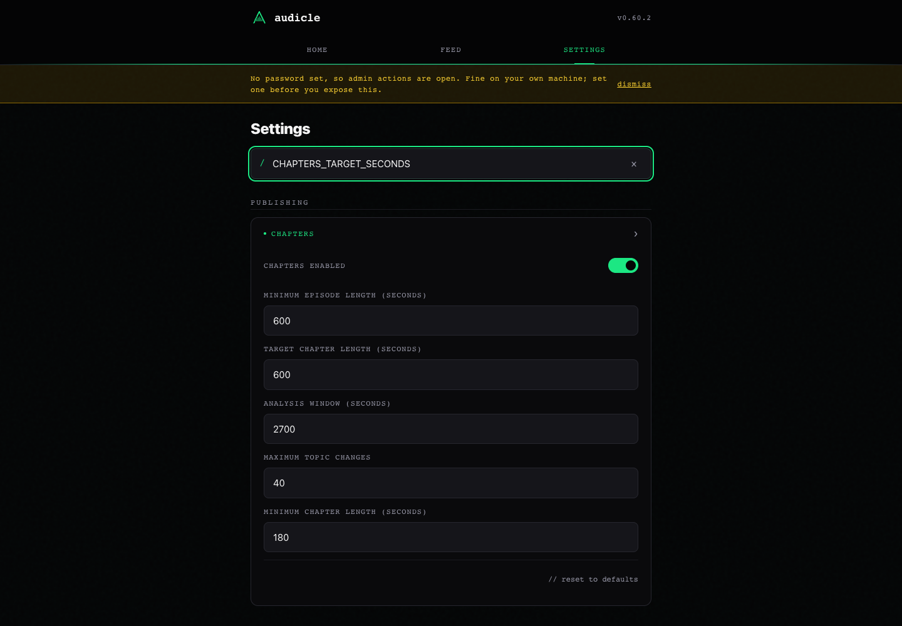 | 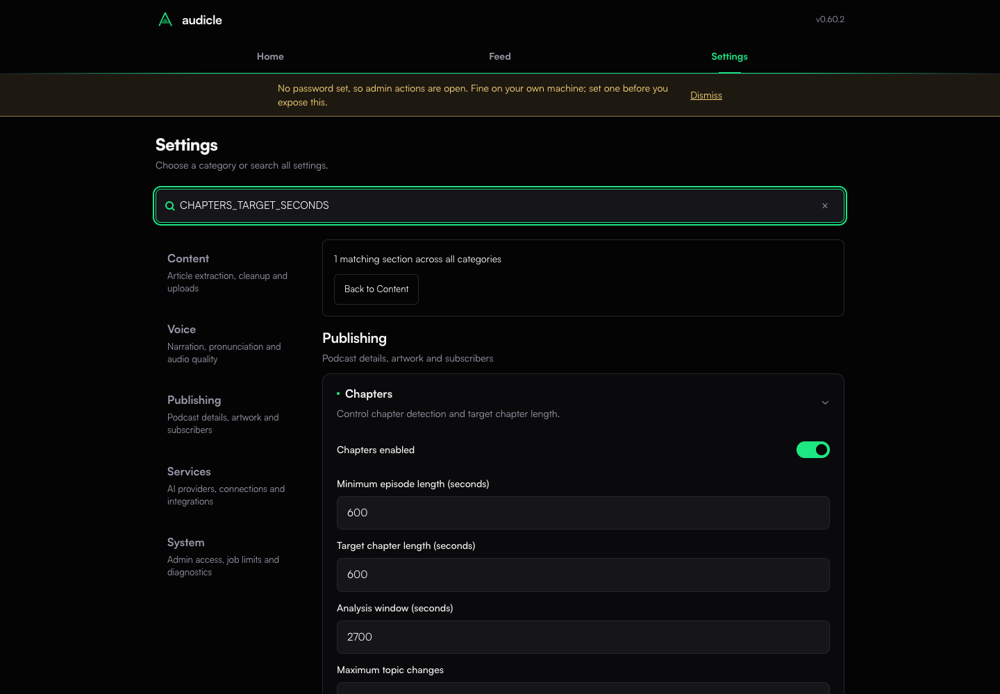 |

### Home and Feed

| Screen | Before | After |
| --- | --- | --- |
| Home desktop | 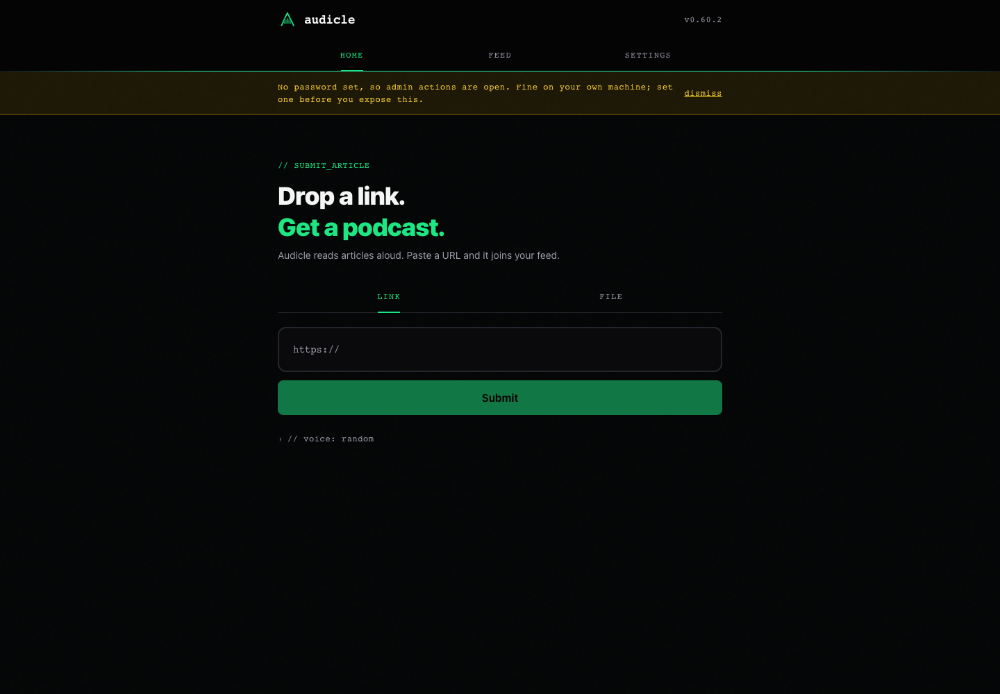 | 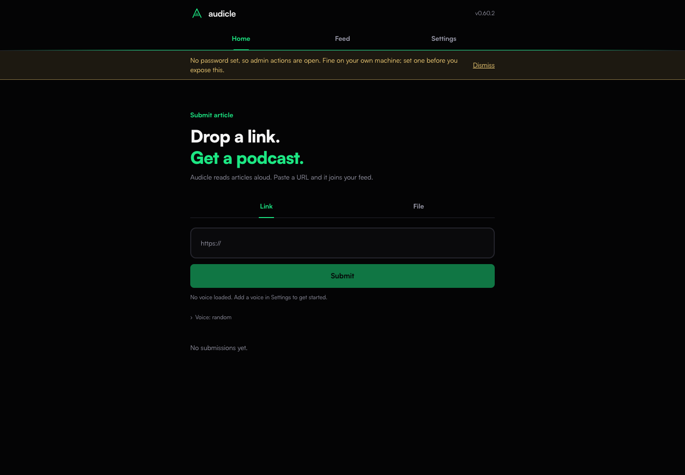 |
| Home mobile | 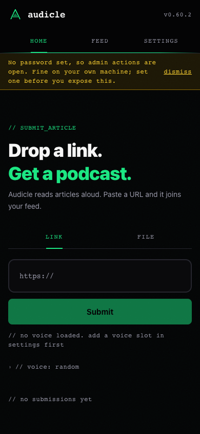 | 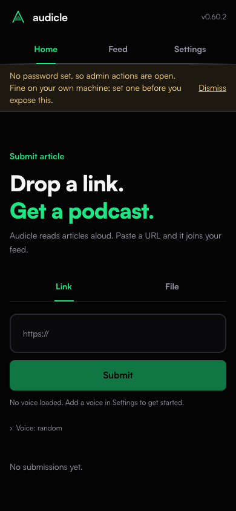 |
| Feed desktop | 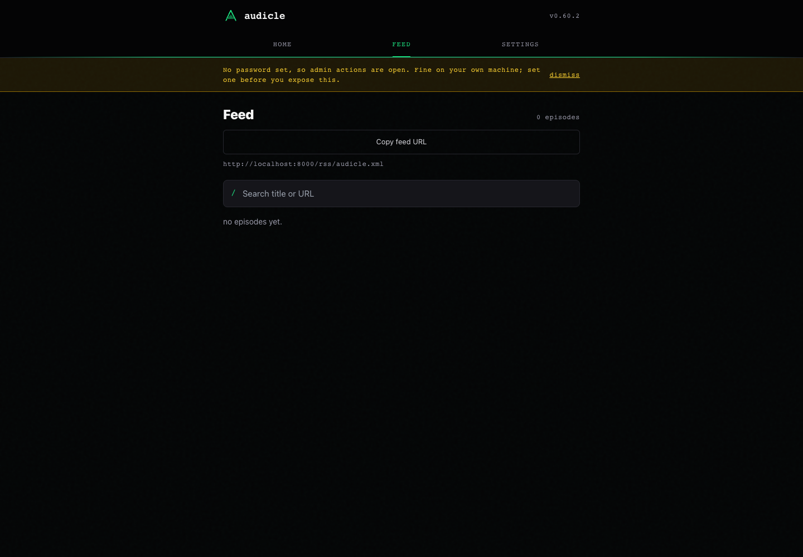 | 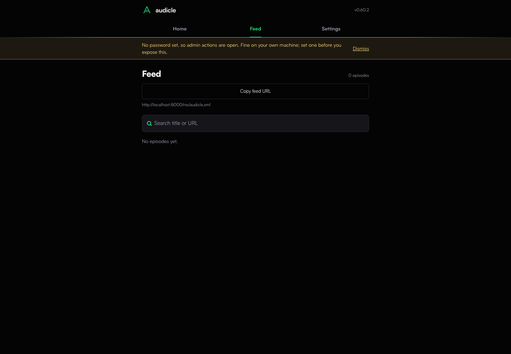 |
| Feed mobile | 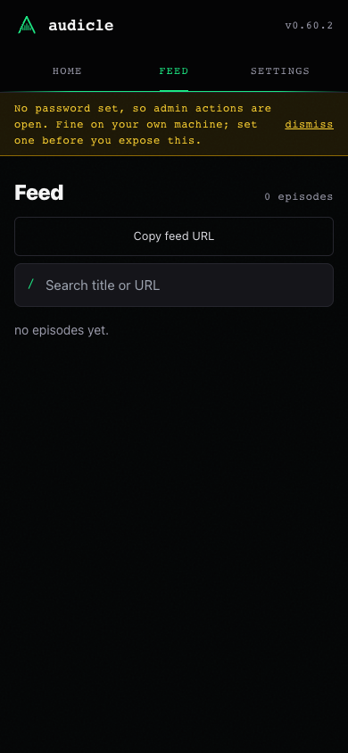 | 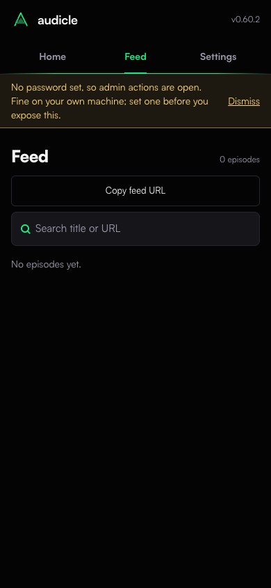 |

### Login and admin feedback

These additional captures use real password validation in the temporary audit database. They show the final mobile typography and error treatment.

| Sign in | Admin access |
| --- | --- |
|  | 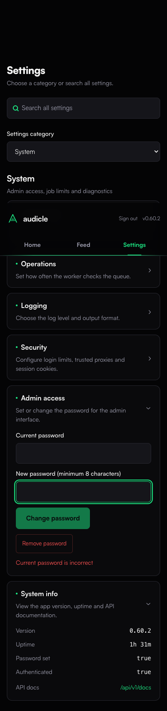 |

## Reproduce

Run the backend against an empty temporary directory, then start Vite from `frontend/`. The backend command keeps audit data separate from an existing installation:

```sh
env DATA_DIR=/private/tmp/audicle-ui-audit-data AUDICLE_SKIP_LEXICON_SYNC=1 .venv/bin/uvicorn app.main:create_app --factory --app-dir backend --host 127.0.0.1 --port 8000
```

The scripts use Playwright with local Chrome and WebKit. Install Playwright in a separate tooling directory and expose its `node_modules` through `NODE_PATH`, or use an existing installation. Set `AUDICLE_URL` to change the local frontend address.

```sh
node docs/audits/ui-2026-10-19/capture.cjs before
node docs/audits/ui-2026-10-19/capture.cjs after
node docs/audits/ui-2026-10-19/verify.cjs
```

Run `before` from the baseline checkout with the capture script available there. It overwrites the baseline images; do not run it against the updated UI.

`verify.cjs` checks categories, browser history, generic and widget search, empty results, keyboard selection, draft retention, disclosure relationships, expanded controls and Satoshi loading. It also checks remote credential masking and Feed search focus. It edits drafts only and fails if navigation issues a write request. It supports `AUDICLE_ENGINE` and `AUDICLE_WIDTH` for focused reruns.

Run authentication checks only against the disposable audit database:

```sh
AUDICLE_AUTH_AUDIT=1 node docs/audits/ui-2026-10-19/verify-auth.cjs
```

This script requires open mode, sets a temporary random password, checks failed and successful sign-in, and validates incorrect-password feedback. For local HTTP it temporarily disables secure cookies. It removes the password and restores the cookie policy afterward.

## Scope limits

The audit covers the shared UI and settings navigation. It does not run speech synthesis, exercise paid provider connections, upload voice samples or test populated-feed artwork. Existing save/reset regression tests cover settings mutation behavior. Draft retention lasts while Settings is mounted; navigating away or reloading still discards unsaved edits.

## Validation

| Check | Result |
| --- | --- |
| Frontend regression suite | 17 tests passed |
| Production build and token consistency | Passed |
| Backend UI-serving tests | 2 tests passed |
| Chrome and WebKit browser checks | Passed at 320 px, 390 px, 768 px and 1,440 px widths in both engines |
| Satoshi font loading | Loaded font faces verified on Home and Feed in both engines; verified before every after capture |
| Captured page overflow | None at the recorded desktop and mobile viewports |
| Expanded settings widgets | Controls fit at all audited widths; labels, help and buttons use Satoshi |
| Real authentication | Sign-in and password-error feedback passed in Chrome and WebKit at 390 px width |
| Documentation links and runtime-key coverage | Passed |
| Docker build | Skipped locally at the user's request; shared build paths corrected |

The build still reports the existing CSS optimizer warning for `::highlight(settings-search)`. The browser supports the selector; search also works when text highlighting is unavailable.
