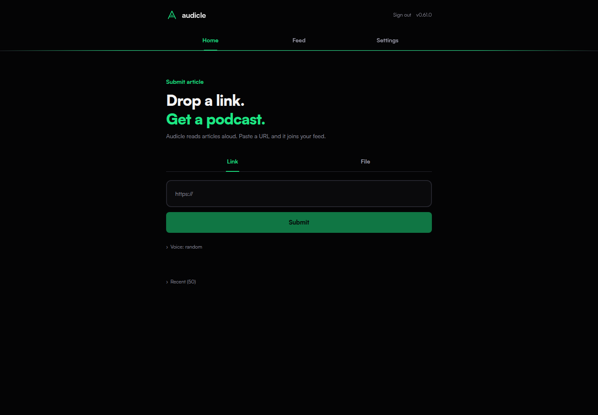
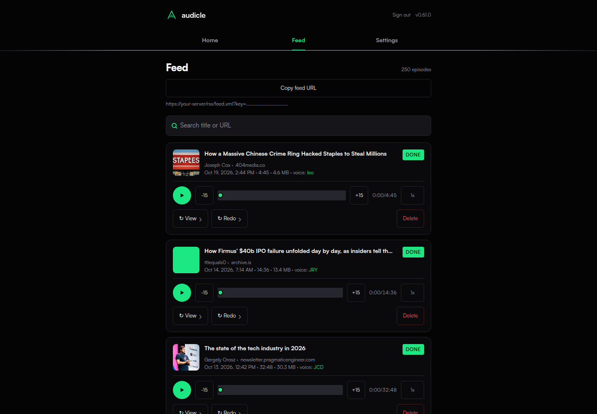
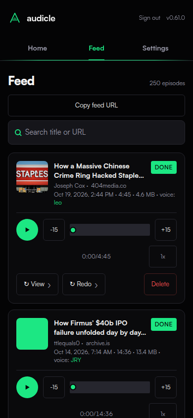
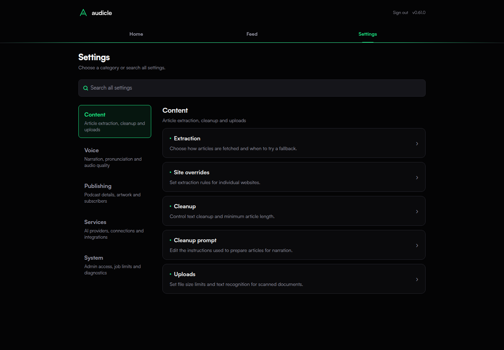
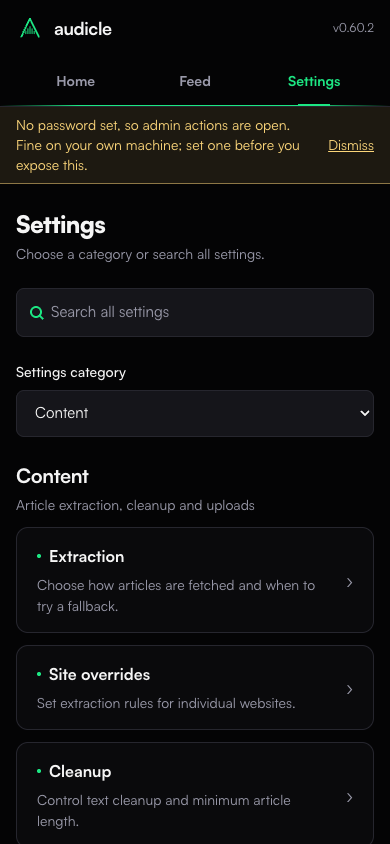

# Web interface

Three pages: Home for submitting, Feed for what you have, Settings for how it behaves. The UI is an installable PWA; on a phone home screen it behaves like an app. When a new version of the interface is ready, a banner offers a reload; the button waits until unsaved Settings changes are saved.

## Home

Paste a URL, or switch to the File tab and drop documents.

  
  

- The file tab takes up to 20 files per batch (PDF including scanned, DOCX, Markdown, text, HTML, or an image). Files upload one at a time, and each becomes its own queued job. One bad file does not sink the batch: an unsupported type or an oversized file is rejected by name at selection, and a duplicate reports "already in the feed" while the rest go through. Failed rows stay in the picker with their reason so you can retry or remove them.
- Each submission picks its narration voice from the picker under the Submit button: Random (a random filled slot), Last used, or a specific slot. See [Voices and TTS](voices-and-tts.md).
- The queue shows running and waiting jobs with per-stage progress; a queued or processing job can be cancelled. Recents lists finished and failed jobs: a failed job can be requeued from here (URL jobs re-fetch, uploads re-run from the stored original), and a finished one can regenerate its chapters without re-synthesizing audio.

## Feed

Your episodes, with inline players, transcripts, and per-episode actions.

  
  

- **Search** covers the whole feed, not the page on screen: it matches episode titles, source URLs, and uploaded filenames as you type. A typed `%` or `_` is literal text, not a wildcard. Clear search or press Escape to reset the query and keep focus in the search field.
- **Pagination** shows 25 episodes per page. The pager appears only when there is more than one page, and deleting the last episode on the last page drops you back a page instead of showing an empty list.
- Per episode: play inline, open the transcript, chapters, or cleaned text, reprocess the whole episode, regenerate chapters alone, or delete it (which also removes its files on disk).
- The player can skip backward or forward by 15 seconds. Playback speed cycles through 0.75x, 1x, 1.25x, 1.5x, and 2x. This browser remembers each episode's position and speed; finished playback resets the position. Reprocessed audio starts with a fresh position.
- The copy button at the top holds the exact subscribe URL, key included when [authenticated feeds](feeds-and-podcasting.md#authenticated-feeds) are on.

## Settings

Choose Content, Voice, Publishing, Services or System from the side navigation. On mobile, use the category selector. Each section has a short description of what it controls.

  
  

- **Search all settings.** Match readable labels, technical keys or section descriptions across categories. Results open automatically; clearing search or pressing Escape returns to the selected category. Matching phrases are highlighted in browsers that support custom text highlights.

  

- The save bar counts pending generic settings across categories. It remains visible while saving or displaying a result. Sections with separate save buttons keep their own drafts; voice uploads, voice renames, chime controls and feed authentication save immediately.
- Each generic settings card has a reset control at its foot, clickable only when something in that card has a saved override or a pending change. Reset restores the environment or code default. It edits the form rather than saving, so a reset is undoable until you press save.
- Drafts survive category changes, search and collapsing a section while Settings stays open. Reloading or leaving the page still discards unsaved changes.

Category URLs such as `/settings?category=voice` support bookmarks and browser Back. Unknown categories open Content. Provider-specific fields appear only for the selected backend.

When an admin password is set, Sign in gates the interface. Manage it under System > Admin access; login and session policies are under System > Security.

What each group holds is covered in [Configuration](configuration.md).

[< Docs index](README.md)
